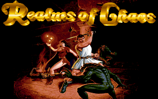
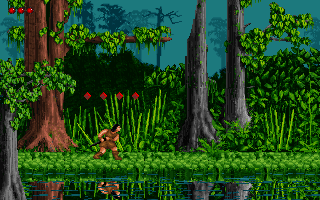
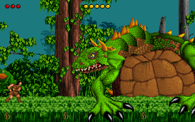
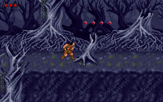
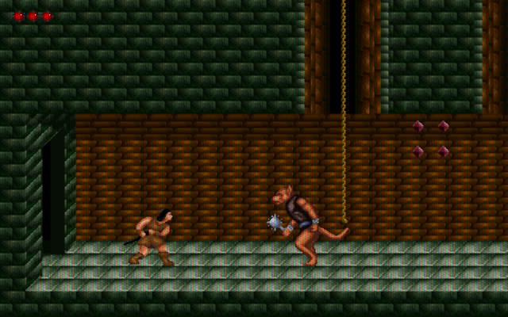

# Realms of Chaos port

A personal learning project: reverse engineering **Realms of Chaos** (Apogee, 1995; DOS, VGA)
with Ghidra, then porting it to run natively on modern systems in C11 and SDL2.

| | |
|:---:|:---:|
|  |  |
| The title screen | The swamp, with its reflections in the water |
|  |  |
| The dragon | The dead forest |


*The castle with the port's CRT filter*

## The port

The port contains no game assets. At run time it reads everything from your own copy of the
game: the graphics, levels, sounds and music from `ROC.DAT`, and a few tables (the AdLib
instruments, the animator and level tables) from `ROC.EXE`. The game logic is reimplemented
in C from the original's machine code, function by function, helped by the Turbo Debugger
symbol table that Apogee left in `ROC.EXE` (the original's function and variable names, types
and source line numbers).

**The whole game is there:** all three episodes and their 27 levels, every creature and boss,
the title, menus and windows, the help and story reader, the Hall of Heroes, the cheats, sound
effects, and the music on an emulated AdLib (the port's own OPL2 emulator, running Apogee's
AL_MIDI driver as read from the machine code). Saved games are compatible both ways: the port
loads the original's `ROC.SG0`-`ROC.SG7`, and saving writes the original's format alongside
its own.

Differences from the original:

- **Music:** always the AdLib (FM) version. The original could also play it through other
  music cards, such as the Gravis UltraSound. By default it plays in stereo, a mode Apogee's driver has but
  `ROC.EXE` never switches on (two chips, the right a little sharp: a wide, chorused sound); the
  original's mono is one menu choice away.
- **The scream on the title screen** as the game starts is left out by default.
- **Port extras:** full screen, a CRT filter, modern game controllers (with the right stick to
  look up and down), all chosen in an "Enhancements" menu (below), and screenshots.
- **The help reader's save** (`ROC.SGT`, written by the original when it opens the help) isn't
  read; the port keeps its own.

Not tried yet: building on macOS, and loading a save written by the port in the DOS game.

### Getting the game

You need your own copy of the registered game: the port was written against version 1.00
(`ROC.EXE`, 543,420 bytes) with all three episodes. It only needs `ROC.EXE` and `ROC.DAT`, in
the same folder (in upper or lower case); the shareware episode hasn't been tried.

### Build (Windows, MSYS2 mingw64)

Needs the MSYS2 packages `mingw-w64-x86_64-gcc`, `-cmake`, `-ninja` and `-SDL2`. From a shell
with `C:\msys64\mingw64\bin` on `PATH`:

```
cmake -S . -B build -G Ninja -DCMAKE_BUILD_TYPE=Release
cmake --build build
```

That produces `build/roc.exe` with `SDL2.dll` copied next to it. SDL2 is the only dependency.

### Build (Linux)

The same commands, with GCC or Clang, CMake, Ninja and SDL2 from the package manager (on Arch:
`pacman -S --needed base-devel cmake ninja sdl2-compat`). That produces `build/roc`.

### The Linux AppImage (Steam Deck, Bazzite and other distributions)

```
packaging/linux/build-appimage.sh
```

builds `dist/RealmsOfChaos-x86_64.AppImage` in a Docker container (Ubuntu 22.04, with SDL2
2.32 built from source and bundled), so it runs on any x86-64 Linux with glibc 2.34 or later:
SteamOS 3, Bazzite, Fedora, Ubuntu 22.04 and later, Arch. Only Docker is needed on the build
machine. The AppImage holds the port and SDL2 only; the game's files stay outside it.

To play, put the AppImage in a folder with `ROC.EXE` and `ROC.DAT` (or with a `game` folder
holding them), make it executable (`chmod +x`, or Properties > Permissions in a file manager)
and run it. On a Steam Deck or Bazzite, add it to Steam in Desktop Mode (Steam > Games > Add a
Non-Steam Game to My Library > Browse) to play it in Gaming Mode; the Deck's controls are the
game controller (Controller Support is on by default). The settings, scores and saves are
written in the game's folder, so it must be writable.

### The Miyoo Mini (Plus) under OnionUI

```
packaging/miyoo/build-onion-port.sh
```

cross-compiles the port in a Docker container and builds `dist/RealmsOfChaos-OnionUI.zip`, laid
out as OnionUI's [Ports Collection](https://github.com/OnionUI/Ports-Collection) lays out its
engine ports. The container has the Miyoo Mini toolchain from shauninman's
[union-miyoomini-toolchain](https://github.com/shauninman/union-miyoomini-toolchain) (GCC 8.3,
glibc 2.28) and XK9274's [sdl2_miyoo](https://github.com/XK9274/sdl2_miyoo), an SDL 2.0.20 with
drivers for the handheld's display, sound and buttons, which goes into the zip. Only Docker is
needed on the build machine. It has been played on a Miyoo Mini Plus, stereo music included.

To install it, extract the zip to the root of the SD card, copy `ROC.EXE` and `ROC.DAT` into
`Roms/PORTS/Games/Realms of Chaos/`, then in Ports run "~Import ports": Realms of Chaos appears
under Platform. The settings, scores and saves are kept in that folder too.

The build for the handheld (CMake's `ROC_MIYOO`) shows the picture doubled to 640 x 400 with
black bars, has no CRT filter, and always uses the handheld's buttons as the game controller.
They keep the places of an Xbox pad's buttons in a level, and the handheld's own meanings in
the menus:

| Button | In a level | Menus and windows |
|--------|------------|-------------------|
| D-pad | walk, climb, crouch | move |
| B | jump | Esc (back) |
| Y | attack | pick (as the attack key) |
| A | the special item (change hero) | Enter |
| X | look (with up / down) | Y at "Press Y" prompts (as Y does) |
| L1 / R1 | look up / down | turn the reader's pages |
| Start | the main menu | Esc (back) |
| Select | the status window | |
| L2 / R2 | quick save / quick load | |

### Run

```
build/roc.exe game/ROC.EXE
```

`ROC.DAT` must be next to `ROC.EXE`. Without `ROC.EXE` on the command line (as when it's started
from Steam or a desktop launcher) the port looks for the game next to the AppImage or the
program, in a `game` folder there, in the current folder, and in its own folder
(`~/.local/share/realms-of-chaos` on Linux, `%APPDATA%\realms-of-chaos` on Windows); if it
isn't in any of them, a message lists them. The port reads and writes `ROC.CFG` (the keys and
settings, as the original's SETUP writes them), `roc.sco` (the Hall of Heroes), the saved games
and its own `ROCP.CFG` in that folder, or in the folder given with `--data-dir`.

Keys (the original's, as the game's `ROC.CFG` sets them; SETUP can change them):

| Key | Action |
|-----|--------|
| Arrows | walk, climb, crouch |
| Ctrl | jump (hold for height) |
| Alt | attack: the male's whip, the female's fireballs (one gem each) |
| Space | the special item (change hero) |
| Right Shift + Up / Down, or PgUp / PgDn | look up / down (without a `ROC.CFG`, Enter is the look key) |
| Esc | the main menu |
| F1 | help |
| F2 / F3 | save / load |
| F8 / F9 | quick save / quick load |
| F4 | sound volumes |
| F5 | the status display on / off |
| F6, Tab or Pause | the status window (pauses the game) |
| F10 | quit |
| F11 | gamma |

In the menus: Up / Down or a line's first letter, Enter (or attack) picks, Esc (or jump) goes
back. The original's cheats work too.

Port keys:

| Key | Action |
|-----|--------|
| Alt+Enter | full screen on / off |
| Alt+C | the CRT filter on / off |
| F12 | save a screenshot (`shotNNN.png`) in the current folder |

Game controllers stand in for the original's PC joystick: Xbox, PlayStation, Switch Pro,
8BitDo and other pads SDL recognises, plugged in at any time (a plain joystick works through
its first two axes, hat and four buttons).

| Control | In a level | Menus and windows |
|---------|------------|-------------------|
| Left stick / D-pad | walk, climb, crouch | move |
| A | jump | Enter |
| X | attack | Y at "Press Y" prompts |
| B | the special item (change hero) | Esc (back) |
| Y | look (with the stick up / down) | Y at "Press Y" prompts |
| Right stick up / down | look up / down | turn the reader's pages |
| Start | the main menu | Esc (back) |

A, X, B and Y are the gameport's buttons 0-3, so in a level they do whatever SETUP assigned to
those buttons (jump, attack, item and look as shipped).

### Enhancements

Game Options (in the main menu) has a last line, **Enhancements**, that turns each of the
port's additions on and off at once:

| Line | Default | What it does |
|------|---------|--------------|
| CRT Filter | on | the look of RetroArch's `2xsal-level2-crt` shader preset: the picture doubled with 2xSaL's smoothed edges, then scaled to the window under a CRT shadow mask (Alt+C) |
| Full Screen | on | the desktop's resolution, the picture scaled to fit with its shape kept (Alt+Enter) |
| Controller Support | on | use a game controller whatever `ROC.CFG` says (off leaves it to SETUP's choice) |
| Music | Stereo | Stereo, or Mono as the original plays it |
| Title Scream | off | the title screen's scream as the game starts, as in the original |

The choices (and Alt+C's and Alt+Enter's) are remembered in `ROCP.CFG`, a small text file next
to `ROC.CFG`. The command-line options below switch one on for a single run without changing
it.

### Command line

```
roc [ROC.EXE] [options]
```

| Option | What it does |
|--------|--------------|
| `--level N` | start a new game at level N (0-26) instead of the title |
| `--difficulty N` | its difficulty: 0 Super Easy ... 4 Psycho Warrior (default 2, Normal) |
| `--data-dir DIR` | read and write the settings, scores and saves in DIR |
| `--fullscreen` | start in full screen |
| `--crt` | start with the CRT filter |
| `--joystick` | use a game controller whatever `ROC.CFG` says |
| `--mono-music` | the music in mono, as the original |
| `--title-scream` | play the title screen's scream |
| `--no-sound` / `--no-music` | play without sound effects / music |

For testing and development, `--screenshot out.png --ticks N` runs the game for N ticks of its
582 Hz timer without a window and saves the screen. It reads and writes no files unless given
`--data-dir`. More options:

| Option | What it does |
|--------|--------------|
| `--hold A:F-T,...` | hold an action (`left`, `right`, `up`, `down`, `jump`, `attack`, `item`, `look`) or a PC scancode (`0x20`) from tick F to T; with `--joystick` also `joyleft`, `joyright`, `joyup`, `joydown`, `button0`-`button3`, `start`, `lookup`, `lookdown` |
| `--pos X,Y` | keep the view's top left corner there |
| `--player X,Y` | put the player there at the start |
| `--trace N` | print the player's state every N ticks |
| `--female` | play the female hero |
| `--gems N` / `--score N` | start with N gems / points |
| `--collect K` | hand the player prize K (0x21 shields, 0x23 lightning, 0x25 death, 0x29 a stronger weapon) |
| `--invincible` | the player can't be hurt (crushing still kills, as in the original) |
| `--boss-hits N` | start the level's boss with N hits taken |
| `--sweep` | move the player across the whole map during the run |
| `--list` | print every object at the end |
| `--no-objects` | don't draw the objects |

Headless runs print the level, the player's position and state, the inventory and the level's
counters at the end. For example, walking right and jumping on the first level:

```
build/roc.exe game/ROC.EXE --level 0 --ticks 3000 --hold right:0-3000,jump:1000-1100 --screenshot out.png
```

`docs/implementation-progress.md` has many more test runs.

## Reverse engineering workflow

`ROC.EXE` isn't packed, and it was linked with Turbo Debugger information: 246 KB of symbols
after the program. To use them in Ghidra:

1. Import `game/ROC.EXE` into Ghidra (format: Old-style DOS Executable (MZ)) and run
   auto-analysis.
2. Export the symbols: `python tools/tdinfo.py game/ROC.EXE analysis/ROC.tdinfo.txt`.
3. Run `tools/ghidra_scripts/ApplyTdInfo.java` and then `FixDisassembly.java` from Ghidra's
   Script Manager, then both once more. That applies the original names, prototypes, structs
   and source lines, and repairs the switch tables Ghidra misreads.

The other tools:

| Tool | What it does |
|------|--------------|
| `tools/rocdat.py` | list or extract `ROC.DAT` (an LHA archive, `-lh5-`) |
| `tools/extract_gfx.py` | render the extracted screens, sprites, tiles and all the level maps to PNG |
| `tools/animators.py` | list the behaviour functions SETUPOBJ gives each object type |
| `tools/gen_imagetab.py` | generate `src/imagetab.h`, the layout of the game's sprite table |

`docs/notes.md` is the reverse engineering reference (formats, the engine, every creature and
boss), and `docs/implementation-progress.md` the port's history and how each part was checked.

## Layout

| Path | Contents |
|------|----------|
| `src/` | The port: C11 + SDL2. The game modules keep the original's names (`rxforest.c` is RXFRSTF.C) |
| `tools/` | Python helpers and Ghidra scripts |
| `packaging/linux/` | The AppImage's build (Docker), desktop file and icon |
| `docs/` | Reverse engineering notes and the port's progress |
| `game/` | Your game files (not committed) |
| `analysis/`, `extracted/`, `gfx/` | Generated from the game files by the tools (not committed) |

## License

The port's source code and tools are released under the MIT License (see `LICENSE`), except
`src/crt.c`, which translates two GPL shaders from RetroArch's collection (`2xsal-level2.slang`
by guest(r), and `dotmask.slang` by cgwg, Timothy Lottes and torridgristle) and is under the GNU
General Public License, version 2 or later. A build of the port includes it, so the program as a
whole is distributed under the GPL.

That covers this repository only: Realms of Chaos itself is (c) 1995 Apogee Software, and none
of its files are included here.
